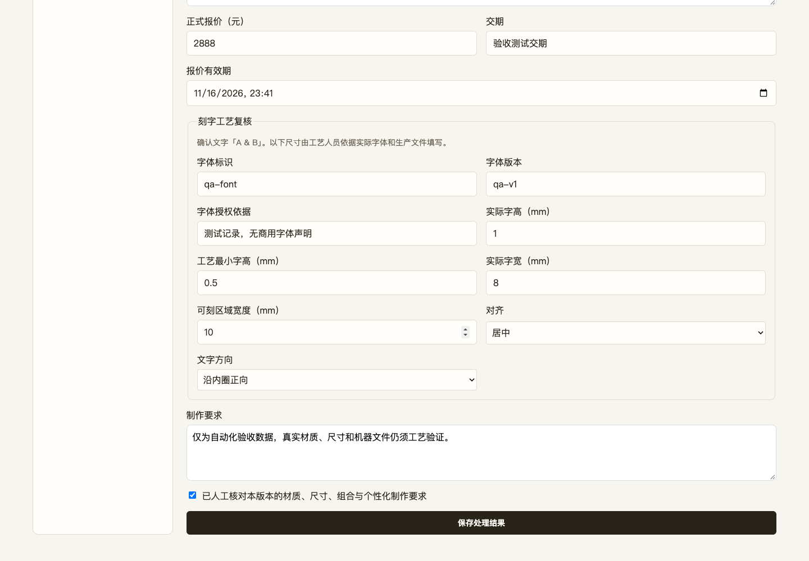
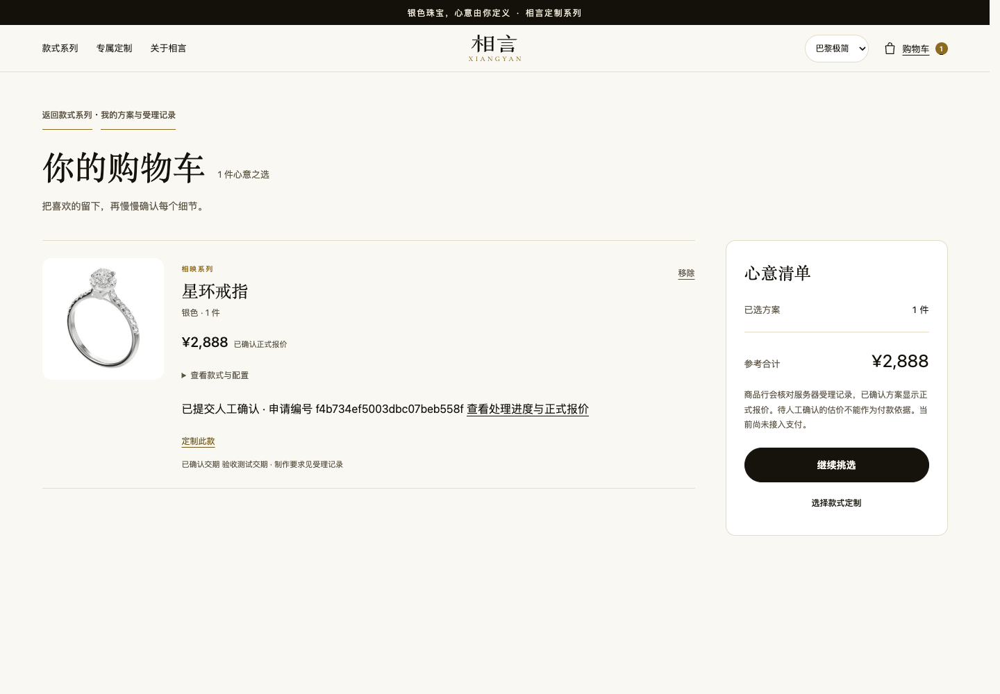
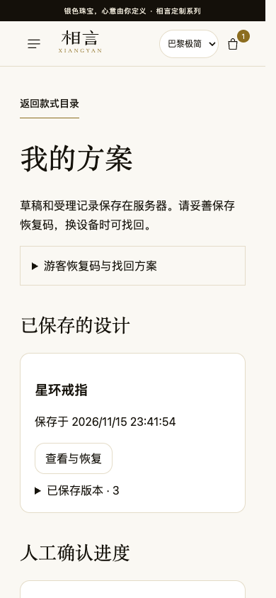

# DIY 需求验收推进记录

依据《饰品 DIY 配置功能详细需求 V0.1》，按 A → B → C → D → E → 刻字与图片个性化推进。2026-11-15 更新。

用户已确认两个边界：目前没有验证过的实物材质、圈号档位、混搭工艺、字体及最小字高，先走待人工确认；账号登录后补，先使用游客恢复码。渲染成功、参考报价和后台发布均不能代替可生产结论。

## A 配置工作台

适用组合编辑器，包括目前发布的原款及上传的新款。后台可发布「先戒头」或「先戒圈与个性化」的步骤顺序，并要求客户填写尺寸与制作说明。当前只提供戒指的固定戒头、戒圈槽位；无对应配钻结构时隐藏配钻选项。

- 最近十步撤销、重做；连带变更作为一步，实际变化均生成新修订。
- 换整款前说明清除项、允许取消、备份目标款式旧草稿；可恢复或下载备份。
- 重置前确认，重置后可撤销，不删除服务器版本或购物车。
- 替换部件先说明不兼容配钻及排钻基准的变化，保留兼容设置与未确认文字。
- 选择卡片包含图片、名称、结构、参考差价和勾选标记。配置摘要及校验问题可定位字段。
- 本机暂存与服务器保存分开显示；服务器确认后才显示成功时间。
- 失效草稿保留原文、解释失效项；备份失败不覆盖。旧版非 UUID 修订迁移时保留内容。
- 未确认文字、制作要求、图片上传中或本机写入失败时提供离开保护，包含浏览器后退。
- 中文输入法组词时不确认刻字，规范化前显示最终文字；手机键盘占用时调整输入区域。

尚未覆盖：真机微信浏览器切后台、真实中文软键盘与横竖屏验收；旧精调围钻实验入口仍保留原有功能，未迁移到这套服务器方案流程。

## B 预览与素材

- 换部件继续保留已显示画面与镜头；当前配置的画面就绪前，不允许截取旧画面提交。
- 部件读取失败可重试；WebGL 丢失时清除可截图状态，显示明确标注的原款参考图，允许重建画布。
- 已发布的历史版本和下架版本仍可读取原素材；不进入当前目录，不能取得新购报价。
- 部件比例和接合坐标需为有效数值；缺失版本不继续装配。
- 服务器设计记录保存所选部件的发布修订及素材清单，不随下一次发布覆盖。

限制：比例和坐标数值有效不代表毫米尺寸或制作公差已经通过工艺验证。参考图不冒充混搭渲染。

## C 校验与报价

- 修改后校验绑定当前修订；旧请求取消，旧结果不能启用提交。
- 必填制作要求缺失为「未完成」：允许保存，提交时定位缺项；服务端也拒绝绕过。
- 网络失败显示重试；下架、旧部件版本、不支持的排钻或配置错误显示原因与重新选择入口。
- 未验证材质、圈号、接合、刻字及图片都进入「需人工确认」，不显示可直接购买。
- 参考价与示例交期明确标注。正式报价必须包含价格、有效期、交期、制作要求和处理人。
- 客户确认前重新检查部件是否仍可售及报价是否有效；过期、状态冲突或版本变化会阻止确认。

自动判定可生产尚未开放。后续工艺提供真实组合、尺寸与材质规则后，才能增加自动可购路径；不能将当前人工路径当作自动规则引擎验收通过。

## D 保存恢复与交接

- 游客拥有随机恢复码。服务器只保存其摘要用于隔离方案，不保存恢复码明文；接口不将它放进 URL。
- 支持服务器保存、多版本查看、跨浏览器恢复、结构化配置下载。持码人可读取对应内容，丢失后暂不能通过账号找回。
- 并发保存使用版本和条件写入；旧页面不能覆盖新版本。失败重试复用已写入的不可变修订。
- 恢复旧版本生成新修订，不能把历史修订重新当作最新保存；本机原草稿先备份。
- 冲突或达到版本限额时可保留当前内容另建方案，不删除服务器原记录。
- 提交返回受理编号。同一修订重复提交返回同一记录，冻结设计、截图和当时估价。
- 客户可查看待复核、待补充、不支持、已报价、已确认等状态；补充说明不改变设计。
- 客户确认绑定指定设计版本、正式报价与制作要求。确认后后台不能改写或替换生产文件；改设计重新提交。
- 购物车关联受理编号、设计及修订，从服务器核对已确认正式报价，保留对应截图；换设备可同步已确认方案到本机购物车。

账号绑定、真实商城订单、付款和库存交接未做；购物车仍为本机清单，没有支付入口。游客每份设计最多保存 100 个修订，每个身份最多 30 份方案和 30 张参考图。

## E 后台与追溯

原有上传复核、部件管理、商品草稿、发布、上下架、价格快照继续使用。新增：

- 商品草稿里的步骤顺序和必填制作要求，随该版发布进入前台；改草稿不影响现有发布版。
- 「方案复核」列表，按状态筛选，查看提交截图、具体配置、尺寸要求、图片、申请编号和设计修订。
- 记录处理人、说明、时间、正式报价与状态历史；不同人同时处理产生冲突时重新读取，不静默覆盖。
- 生产文件私有保存，关联设计修订，记录文件名、摘要和上传时间。更换文件撤销旧报价并回到待复核。
- 个性化方案未关联生产文件时不能给出正式报价。

真实工艺依据仍由工艺人员提供。已有模板尺寸范围管理不能代替单份设计的正式制作结论。

## 刻字与图片个性化

- 同一份已确认文字用于编辑、保存、受理、后台和确认摘要；不支持字符就地提示，不静默删除或缩小。
- 首期单行内圈刻字，支持明确列出的英文字母、数字、空格和 `. & -`；中文和表情未开放。
- 后台填写字体标识、版本、授权依据、位置、对齐、方向、实际字高、工艺最小字高、实际字宽与可刻宽度。
- 服务端拒绝低于最小字高或超出可刻宽度的正式报价。输入数字由工艺人员测量，系统未自动测量字形。
- 接受 JPG、PNG、WebP 参考图，前端重编码为最长边不超过 1600px 的 JPEG；服务端验证尺寸/体积，按游客隔离。SVG 不接收。
- 可选择内圈或外侧戒臂作为期望位置。图片参考不直接生成刻纹，也不宣称能生产。
- 无经过验证的自动生产文件生成器；先由工艺人员准备 PDF、DXF、STEP 或 TXT 文件，关联该修订后再报价、由客户确认。

仍需真实字体、授权、样件、可刻区域、机器格式和字形/排版对照验证。多行、多位置和自动凹刻几何没有加入本轮。

## 验证证据

- 单元与组件：222 项通过、1 项原有跳过；现有两组几何检查通过，包含 256 组边界组合。
- `npm run build` 通过；保留原有大包、动态导入和 Three.js 兼容提示。
- A 浏览器测试：真实本地模型，桌面 1440×1000、手机 390×844、键盘占用 390×440；换款、备份/恢复、后退取消、刻字、购物车截图。
- B 浏览器测试：主动触发 WebGL 丢失、阻断部件请求，验证不能提交旧帧，重试后恢复。
- C–E 浏览器测试：正式构建页面 + 实际 consumer 服务代码 + 隔离内存存储及测试后台会话。经过保存、恢复码换浏览器、上传图片、申请受理、生产文件、错误刻字宽度拒绝、报价确认、购物车、再次编辑、恢复历史修订、模板必填项及手机页面。
- 浏览器测试使用虚构的报价和工艺数值；没有改写真实 R2 客户数据。该验证不是 Vercel/R2 线上验收，本轮尚未部署。
- [逐项浏览器结果](acceptance-evidence/cde-results.json)

